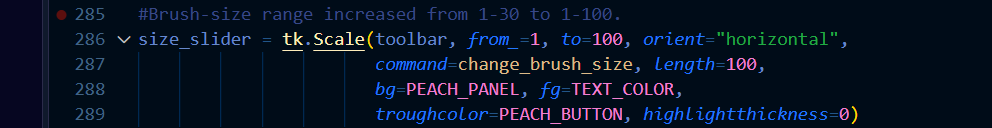
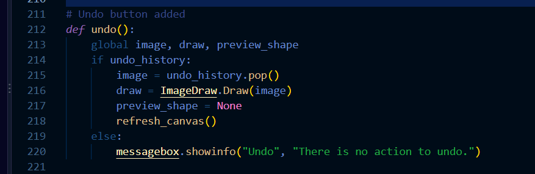
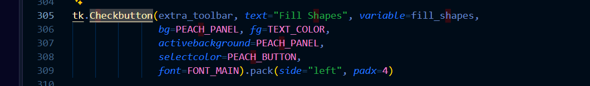

# README.md file

# REQUIREMENTS COMPLETED:

✓ **Bigger brush range**

What I did here, ma'am, was change the brush-size slider. Originally, the maximum brush size was only 30. I increased it to 100 so the user can draw with thicker lines.

**Code:**



To change the range, I simply changed `to=30` to `to=100`. The minimum size remains 1.

---

✓ **Undo button**

I added an Undo button so the user can reverse the most recent drawing action. Before drawing, the program saves a copy of the current image. When Undo is clicked, the previous image is restored.

**Code:**



---

✓ **Filled shapes**

I added a Fill Shapes checkbox. When the checkbox is selected, rectangles and ovals are filled with the currently selected color. When it is not selected, the shapes remain outlines.

**Code:**



I used the same fill setting for the rectangle, oval and the additional triangle shape.

---

✓ **Extra shape tool: Triangle**

I added a Triangle button alongside the original drawing tools. The user can click and drag on the canvas to create a triangle. A preview appears while dragging, and the final triangle is drawn when the mouse button is released. (same to all shapes)

**Code:**

.png?raw=true)

I added the triangle to the shape preview function as well, so the user can see its size before finishing the drawing.

---

✓ **Confirm before clearing**

**Example:** I modified the original Clear function. Instead of immediately deleting the drawing, the program now asks the user to confirm the action. If the user selects Yes, the canvas is cleared. If the user selects No, the drawing stays on the canvas.

**Added confirmation code:**

```python
answer = messagebox.askyesno(
    "Clear Canvas",
    "Are you sure you want to clear the canvas?"
)

if answer:
    save_undo_state()
    image = Image.new("RGB", (CANVAS_WIDTH, CANVAS_HEIGHT), "white")
    draw = ImageDraw.Draw(image)
    preview_shape = None
    refresh_canvas()
```

This also saves the previous canvas before clearing, so the user can use Undo to restore it.

---

✓ **Quick colors**

**Example:** I added six quick-color buttons so the user does not need to open the color chooser every time they want to change colors. The buttons are Black, Red, Blue, Green, Yellow, and Purple.

**Added function:**

```python
def set_quick_color(color):
    global current_color, tool
    current_color = color
    tool = "brush"
    color_button.config(bg=current_color)
```

**Quick-color choices:**

```python
quick_colors = [
    ("Black", "black", "white"),
    ("Red", "red", "white"),
    ("Blue", "blue", "white"),
    ("Green", "green", "white"),
    ("Yellow", "yellow", "black"),
    ("Purple", "purple", "white")
]
```

Each button calls `set_quick_color()` with its own color. The original Choose Color button is still available for selecting a custom color.

---

✓ **Green and white user interface**

**Example:** I changed the original peach color palette to a green-and-white theme. The window background is light green, the toolbar panels are white, the buttons are soft green, and the text is dark green.

**Modified color settings:**

```python
PEACH_BG = "#EAF7EA"       # light green window background
PEACH_PANEL = "#FFFFFF"    # white toolbar background
PEACH_BUTTON = "#A8D5A2"   # soft green buttons
PEACH_HOVER = "#78B879"    # darker green on hover
TEXT_COLOR = "#214D2B"     # dark green text
```

The existing color variable names were retained to avoid changing the original code structure. Only their color values were changed.

---

# ORIGINAL BUTTONS RETAINED

I kept all the buttons from the original program:

- Choose Color
- Brush
- Eraser
- Line
- Rectangle
- Oval
- Brush Size
- Clear
- Open
- Save

The new Triangle, Fill Shapes, Undo, and Quick Colors controls were added without removing the original buttons.

# HOW TO RUN THE PROGRAM

1. Open the project folder in Visual Studio Code.
2. Open **Terminal → New Terminal**.
3. Install Pillow if it is not installed yet:

```bash
python -m pip install pillow
```

4. Run the program:

```bash
python paint_application.py
```

If `python` is not recognized, use `py` instead:

```bash
py -m pip install pillow
py paint_application.py
```

# SCREENSHOT

After running the program, take a screenshot showing the complete application window, including the canvas and both toolbar rows. On Windows, press **Win + Shift + S** to capture the screen.
